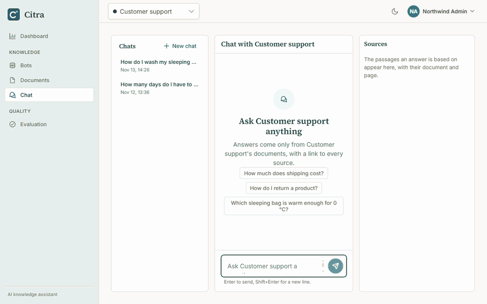
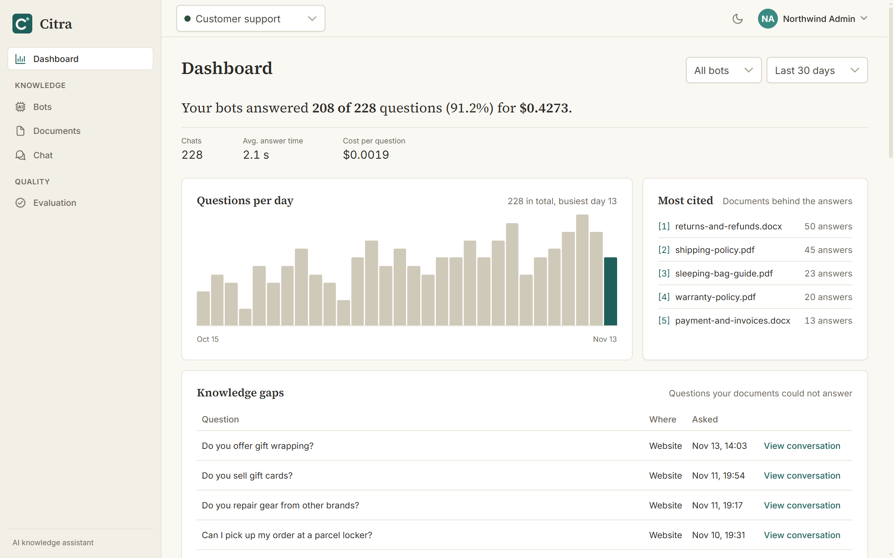
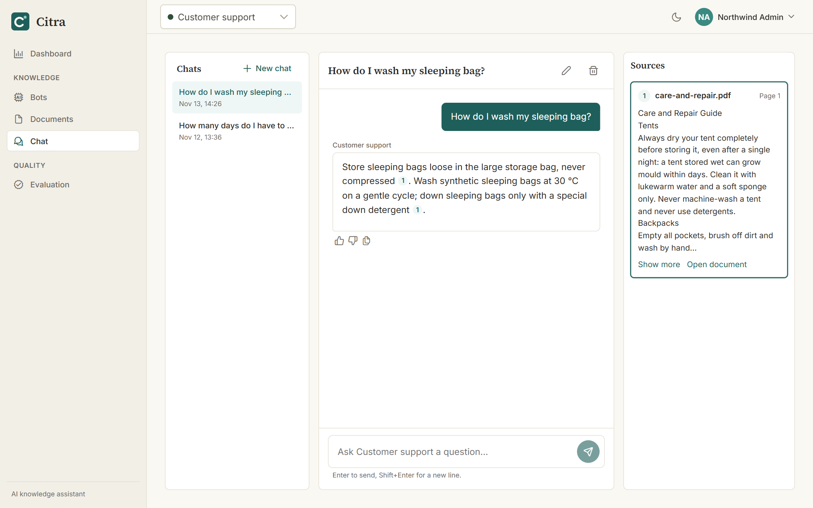
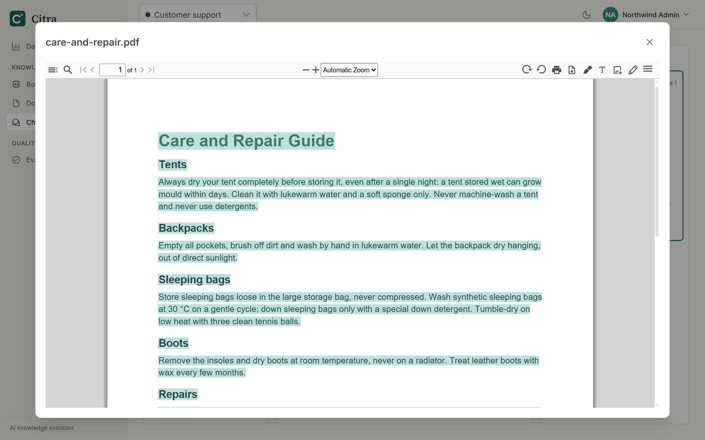
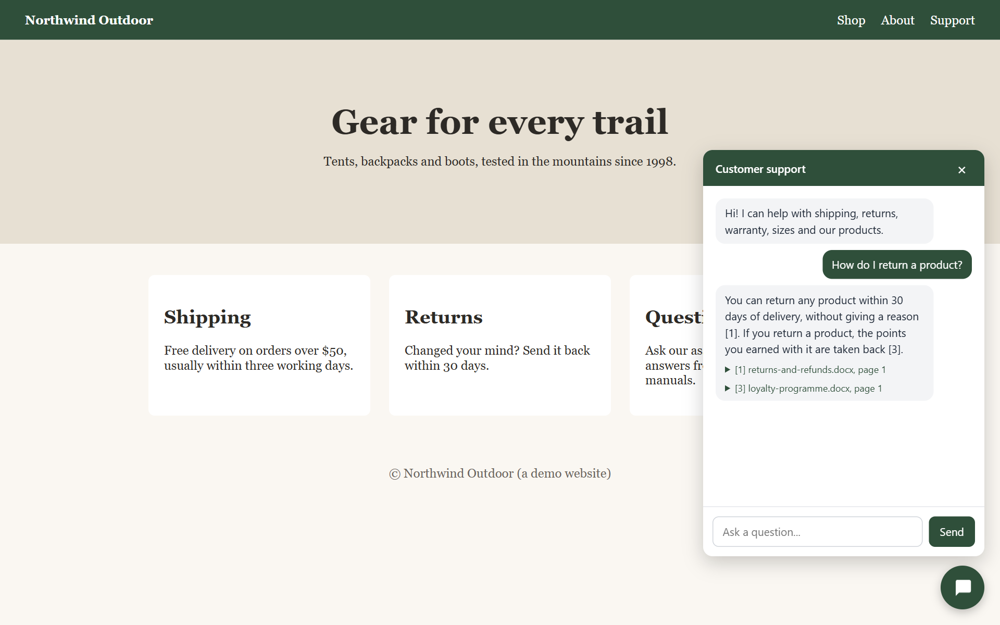
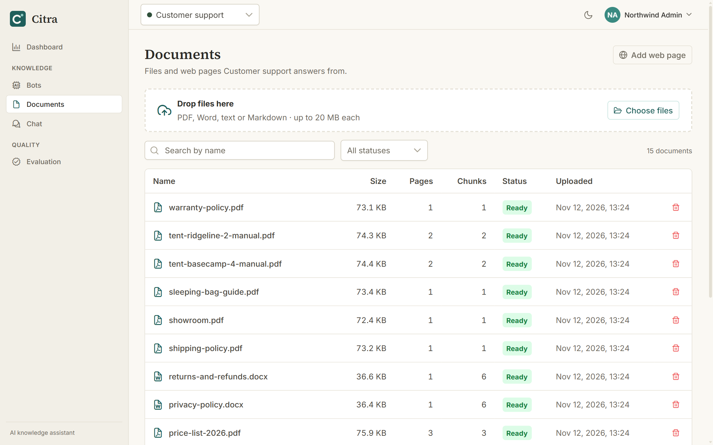
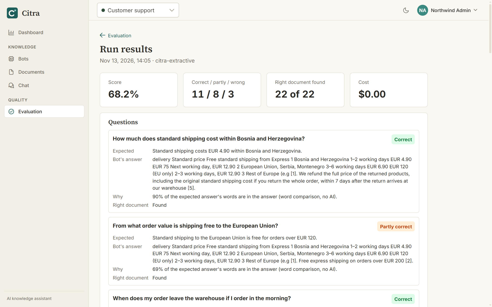
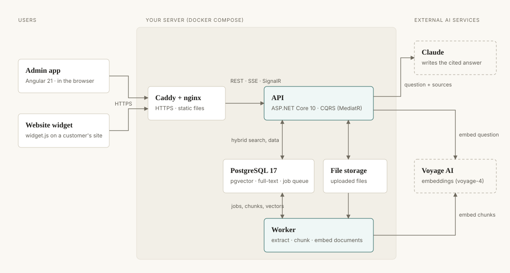

# Citra

An AI knowledge assistant for companies: it answers questions from your own documents, and every answer links to
the exact passage it comes from.

Upload PDFs, Word files or web pages. Your team asks in the admin app, your customers ask in a chat widget on
your website, and you see what was asked, what could not be answered and how accurate the bot is.

**[Live demo](https://citra-demo.germanywestcentral.cloudapp.azure.com)** — click **Try the demo** to look around
a sample company, read-only, without an account.



## Features

- **Answers with citations.** Each sentence carries a numbered citation. A click shows the passage, and
  "Open document" opens the PDF on the cited page with the passage highlighted.
- **Only from your documents.** When the documents do not contain the answer, the bot says so instead of
  guessing, and the question is recorded as a knowledge gap.
- **Documents.** PDF, Word, text, Markdown and web pages. A background worker extracts, chunks and embeds them;
  the page shows live progress.
- **Hybrid search.** Vector search (meaning) and full-text search (exact words) in PostgreSQL, combined with
  Reciprocal Rank Fusion.
- **Website widget.** One `<script>` tag puts a bot on any website, with your color, welcome message, starter
  questions, allowed websites and a daily message limit.
- **Dashboard.** Questions per day, answer rate, cost, most cited documents, knowledge gaps and badly rated
  answers.
- **Evaluation.** Test sets of questions with expected answers. A run scores the bot and shows whether search
  found the right document, so you can compare runs after changing documents or settings.
- **Multi-tenant.** Every company has its own bots, documents and users; a global query filter keeps companies
  apart.

## Screenshots

| | |
|---|---|
|  Dashboard |  Chat with citations |
|  The cited passage in the PDF |  Widget on a customer website |
|  Documents |  Evaluation results |

The screenshots show the demo company "Northwind Outdoor" (`demo-data/`) with sample chat history.

## Architecture



| Part | Technology |
|---|---|
| API | ASP.NET Core 10, CQRS with MediatR, FluentValidation, EF Core |
| Worker | .NET 10 background service: text extraction, chunking, embedding |
| Database | PostgreSQL 17 with pgvector (HNSW index) and full-text search |
| Admin app | Angular 21 (signals, standalone components), PrimeNG |
| Widget | TypeScript, built with Vite into one `widget.js`, rendered in a shadow DOM |
| AI | Voyage AI `voyage-4` embeddings; Claude for answers |
| Deployment | Docker Compose, Caddy (HTTPS), nightly database backups, GitHub Actions CI |

How a question becomes a cited answer is described in **[docs/rag-pipeline.md](docs/rag-pipeline.md)**.

## Technical decisions

- **PostgreSQL for everything.** Data, vectors, full-text search and the document job queue live in one
  database. There is no separate vector store or message broker to run, back up and keep in sync.
- **Hybrid search with rank fusion.** Vector search misses exact terms such as product codes; keyword search
  misses rephrased questions. Rank fusion combines both without comparing their very different scores.
- **Chunks follow the document.** A chunk never crosses a heading or a page, so a citation always points to one
  section on one page.
- **"Not found" is a first-class answer.** The model marks an answer it cannot give from the sources. The marker
  is hidden from the reader and feeds the knowledge-gaps list.
- **Documents are data, not instructions.** The prompt tells the model to ignore instructions inside documents
  and questions, and the bot owner's own instructions cannot override the citation rules.
- **The answer model is replaceable.** Answers go through one interface with two implementations: Claude, and a
  free stand-in that quotes the best-matching sentences. The stand-in lets the whole product run, and its tests
  pass, without paid API calls. **The live demo runs on the stand-in**, so its answers are quotes from the
  documents rather than written answers.
- **Streaming.** Answers stream over server-sent events; document progress arrives over SignalR.
- **Tested against a real database.** About 1,000 backend integration tests run on PostgreSQL in Testcontainers,
  and about 450 frontend tests run in CI.

## Run it locally

You need Docker and a free [Voyage AI](https://www.voyageai.com) API key (documents cannot be indexed without
it).

```bash
git clone https://github.com/h0pi/Citra.git
cd Citra
cp .env.example .env    # fill in POSTGRES_PASSWORD, JWT_SIGNING_KEY and VOYAGE_API_KEY
docker compose up -d --build
```

Open http://localhost:8080 and create an account. The first build takes about 10 minutes.

- **Answers from Claude:** set `CHAT_PROVIDER=Anthropic` and `ANTHROPIC_API_KEY` in `.env`. The default,
  `Extractive`, is the free stand-in.
- **Demo company:** `demo-data/README.md` explains how to load Northwind Outdoor with its two bots, 25 documents
  and test questions.
- **Server with HTTPS:** see `deploy/README.md`.

### Development

```bash
docker compose -f docker-compose.dev.yml up -d                  # PostgreSQL with pgvector on port 5433
cd backend
dotnet user-secrets set "Voyage:ApiKey" "<your key>" --project src/Citra.Api
dotnet run --project src/Citra.Api --launch-profile https       # API on https://localhost:7100
dotnet run --project src/Citra.Worker                           # document processing
cd ../frontend && npm ci && npm start                           # admin app on http://localhost:4200
```

Tests: `dotnet test --project tests/Citra.IntegrationTests` in `backend/` (needs Docker), and `npx ng test` in
`frontend/`.

## License

[MIT](LICENSE)
